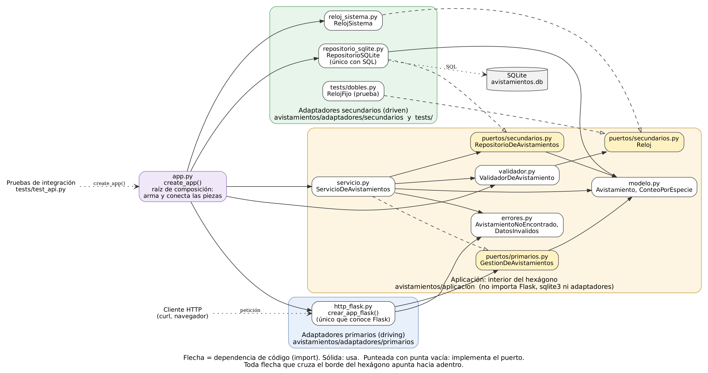

# Taller 5: Clean Architecture y arquitectura hexagonal

Ingeniería de Software 2 (ISW-2). Miércoles 11 de noviembre de 2026. Trabajo individual. API de avistamientos de aves (Python + Flask + SQLite).

- **Repositorio:** <https://github.com/Daniel30456/api-avistamientos>
- **Rama:** `MAIN`
- **Arquitectura elegida:** hexagonal, o puertos y adaptadores (Cockburn, 2005)

## Parte 1. Investigación

### 1. El problema de Cockburn, puertos, adaptadores y la simetría

**El problema.** Cockburn ve que en muchas aplicaciones la lógica de negocio se mete en el código de la interfaz de usuario. Eso trae tres consecuencias. Primero, no se puede probar el sistema con pruebas automáticas, porque parte de la lógica depende de detalles visuales que cambian seguido. Segundo, no se puede pasar de un uso manejado por una persona a uno por lotes. Tercero, es difícil que otro programa use la aplicación (Cockburn, 2005). También cuenta que la solución típica, agregar una capa nueva con la promesa de no meterle lógica de negocio, vuelve a fallar con los años porque nada detecta cuando se rompe esa promesa (Cockburn, 2005). Del otro lado pasa algo parecido: si la lógica queda amarrada a la base de datos y el servidor se cae o se reemplaza, los programadores no pueden trabajar (Cockburn, 2005).

**Puerto.** Es un punto por donde la aplicación conversa con el exterior. Se define por el *propósito* de esa conversación, no por la tecnología, y toma la forma de una API. Cockburn lo compara con los puertos de un computador: cualquier dispositivo que cumpla el protocolo se puede conectar (Cockburn, 2005).

**Adaptador.** Es lo que traduce entre la API del puerto y las señales de una tecnología concreta. Un mismo puerto puede tener varios adaptadores. En el lado del usuario, por ejemplo, una GUI, un arnés de pruebas automatizadas o un programa batch. En el lado de los datos, un adaptador SQL, uno de archivo plano o una base de datos falsa ("mock") en memoria (Cockburn, 2005).

**La simetría.** Cockburn dice que el problema del lado del usuario y el del lado de la base de datos tienen la misma causa: la lógica de negocio enredada con la interacción con entidades externas. Por eso la diferencia importante no es izquierda contra derecha (o arriba contra abajo, como en el dibujo de capas), sino **adentro contra afuera**. La aplicación está adentro y todo lo externo (personas, pruebas, otros programas, bases de datos) se trata de la misma forma, conectado por puertos y adaptadores (Cockburn, 2005). Más adelante distingue los puertos primarios, de los actores que manejan la aplicación, y los secundarios, de los actores que la aplicación maneja, como la base de datos. Aclara que esa distinción es una consecuencia del patrón y no un reemplazo de la idea de simetría (Cockburn, 2005).

### 2. Los círculos de Clean Architecture y la regla de dependencia

Martin (2012) dibuja cuatro círculos. De adentro hacia afuera:

- **Entidades (Entities).** Las reglas de negocio más generales de la empresa. En una sola aplicación, son sus objetos de negocio. Son lo que menos debería cambiar cuando cambia algo externo (Martin, 2012).
- **Casos de uso (Use Cases).** Reglas de negocio *propias de esta aplicación*. Orquestan el flujo de datos hacia y desde las entidades. Cambian si cambia lo que hace la aplicación, pero no si cambia la base de datos, la interfaz o el framework (Martin, 2012).
- **Adaptadores de interfaz (Interface Adapters).** Convierten los datos del formato que les sirve a los casos de uso al formato que le sirve a lo externo, como la web o la base de datos. Aquí van los controladores, presentadores y vistas, y todo el SQL queda restringido a esta capa (Martin, 2012).
- **Frameworks y drivers.** La base de datos, el framework web y otras herramientas. Casi solo se escribe código de "pegamento". Son detalles, y por eso se dejan afuera, donde hacen poco daño (Martin, 2012).

**La regla de dependencia (The Dependency Rule).** Las dependencias de *código fuente* solo pueden apuntar **hacia adentro**. Un círculo interno no puede saber nada de uno externo. En concreto, el código de adentro no puede nombrar ninguna función, clase o variable declarada afuera, ni usar formatos de datos de afuera, sobre todo los que genera un framework (Martin, 2012). Prohíbe, por ejemplo, que un caso de uso importe la librería de la base de datos o reciba una fila del ORM. Martin aclara que no tienen que ser exactamente cuatro círculos, pero la regla aplica siempre (Martin, 2012).

### 3. Cómo guarda datos un caso de uso sin depender de la base de datos

La contradicción está en que el **flujo de control** va de adentro hacia afuera (el caso de uso llama a la persistencia), mientras que la **dependencia de código** tiene que ir de afuera hacia adentro. Martin la resuelve con el principio de inversión de dependencias. Se pone una interfaz en el círculo de adentro, el caso de uso llama a esa interfaz y una clase del círculo de afuera la implementa. Gracias al polimorfismo, la dependencia de código queda en sentido contrario al flujo de control (Martin, 2012). Martin lo muestra con el presentador (el "Use Case Output Port") y dice que la misma técnica sirve para cruzar cualquier frontera (Martin, 2012). Es la misma idea del `RateRepository` de Cockburn y de las interfaces de repositorio de Palermo (Cockburn, 2005; Palermo, 2008).

Cuando llega un-POST, el control va del servicio al `RepositorioSQLite`, pero en el código el servicio nunca nombra a `RepositorioSQLite` ni importa `sqlite3`. El que importa es el adaptador, y lo que importa es la interfaz del núcleo. La pieza concreta se elige en `app.py`, que es el punto de arranque, y se le pasa al servicio por el constructor. Ya teníamos el mismo mecanismo con la fecha: el validador pide un `Reloj`, la aplicación real le pasa `RelojSistema` y las pruebas le pasan `RelojFijo`.

### 4. Comparación: hexagonal, cebolla y Clean Architecture

**Lo que tienen en común.**

Las tres ponen la lógica de negocio en el centro y mandan la infraestructura (interfaz, base de datos, frameworks) al borde, como algo reemplazable. Las tres se apoyan en la inversión de dependencias: el centro define interfaces y el borde las implementa (Cockburn, 2005; Palermo, 2008; Martin, 2012). Palermo lo dice directamente: la hexagonal y la de cebolla comparten la premisa de sacar la infraestructura hacia afuera y escribir adaptadores (Palermo, 2008). Martin agrega que todas buscan separar responsabilidades con al menos una capa de reglas de negocio y otra de interfaces, y que producen sistemas independientes del framework, de la interfaz y de la base de datos, y fáciles de probar (Martin, 2012).

**Lo que cambia:**

|             | Hexagonal (Cockburn, 2005)                                                             | Cebolla (Palermo, 2008)                                                    | Clean (Martin, 2012)                                                            |
|-------------|----------------------------------------------------------------------------------------|----------------------------------------------------------------------------|---------------------------------------------------------------------------------|
| Imagen      | Adentro/afuera; un hexágono con puertos                                                | Capas concéntricas                                                         | Círculos concéntricos                                                           |
| Vocabulario | Puerto, adaptador, primario/secundario                                                 | Modelo de dominio, interfaces de repositorio, UI, infraestructura, pruebas | Entities, Use Cases, Interface Adapters, Frameworks and Drivers                 |
| Interior    | No lo subdivide: "la aplicación" es una sola caja                                      | Varias capas; el número varía y el modelo de dominio está en el centro     | Cuatro capas sugeridas, pero esquemáticas                                       |
| Énfasis     | Tratar igual todo lo externo y poder correr la aplicación aislada, con pruebas y mocks | Controlar el acoplamiento y sacar la base de datos del centro              | Una regla explícita (la de dependencia) y qué datos pueden cruzar las fronteras |

Lo que más cambia es el vocabulario y cuánto se subdivide el centro. La hexagonal no dice cómo organizar el interior; la cebolla y Clean sí. Clean, además, agrega una regla sobre qué datos cruzan las fronteras: estructuras simples, nunca filas de la base de datos (Martin, 2012). Palermo pone un límite de uso: dice que su arquitectura no es para sitios pequeños sino para aplicaciones de negocio de larga vida o con comportamiento complejo (Palermo, 2008).

### 5. ¿Se justifica aplicarle Clean Architecture a esta API?

**Mi posición: sí, en una versión liviana.** Se justifica separar el núcleo de Flask y de SQLite. No se justifica toda la maquinaria completa.

**Costo concreto (trade-off).** Hay más archivos y más saltos para muy poca lógica. La API pasó de 2 archivos de Python con 150 líneas (`app.py` y `validador.py`) a 16 archivos con 373 líneas. Para entender un POST ahora hay que pasar por el adaptador HTTP, el puerto primario, el servicio, el validador, el puerto del repositorio y el adaptador SQLite. Para una sola regla de validación es mucho código de paso. Palermo mismo advierte que su arquitectura no es apropiada para sitios pequeños (Palermo, 2008).

**Beneficio concreto.** La lógica ya no depende ni de Flask ni de SQLite, así que se puede usar y probar sin levantar el servidor ni la base de datos, que era justo lo que buscaba Cockburn al poder correr la aplicación aislada con mocks (Cockburn, 2005). En esta API ya se vio con el reloj: la regla de "fecha no posterior a hoy" se prueba con `RelojFijo` sin depender del día en que se corran las pruebas. Ahora pasa lo mismo con la persistencia: para probar `ServicioDeAvistamientos` alcanza con un repositorio en memoria, y si se cambia SQLite por otra base solo hay que escribir un adaptador nuevo. Martin llama a esto un sistema que se puede probar por naturaleza y cuyas piezas externas se reemplazan con poco esfuerzo (Martin, 2012). Hubo además un beneficio que no esperaba: al sacar el manejo de conexiones de Flask y llevarlo al adaptador, desaparecieron las advertencias de "conexión a la base de datos no cerrada" que salían en las pruebas.

**Conclusión.** El costo se paga una sola vez y es pequeño porque la API es pequeña. El beneficio, probar sin infraestructura y poder cambiar piezas, se nota desde ya y crece si la API crece. Lo que sí sería exagerado es aplicar todo: presentadores, *output ports* y objetos de transferencia para cada frontera. Ahí el costo supera al beneficio. Por eso apliqué las capas y la regla de dependencia, y dejé que el adaptador HTTP convierta directamente los objetos del modelo a JSON.

## Parte 2. Aplicación

### Arquitectura elegida: se hizo un experimiento con el claude y el escogio esta hexagonal (puertos y adaptadores)

Se eligio porque la API ya tenía la idea en pequeño: el validador recibía un reloj y las pruebas le pasaban `RelojFijo`. Eso es un puerto secundario con un adaptador de prueba, solo que sin ese nombre. La hexagonal también se ajusta al tamaño de la API, porque no obliga a dividir el interior en varias capas (Cockburn, 2005).

Para no mezclar arquitecturas, solo usé el vocabulario de Cockburn: **aplicación** (el interior), **puerto primario/secundario** y **adaptador primario/secundario** (Cockburn, 2005).

### Estructura de carpetas

```text
api-avistamientos/
├── app.py                                 # arranque y composición: arma y conecta las piezas
├── avistamientos/
│   ├── aplicacion/                        # INTERIOR del hexágono (sin Flask ni sqlite3)
│   │   ├── modelo.py                      # Avistamiento, ConteoPorEspecie
│   │   ├── validador.py                   # regla de validación (ValidadorDeAvistamiento)
│   │   ├── errores.py                     # AvistamientoNoEncontrado, DatosInvalidos
│   │   ├── servicio.py                    # ServicioDeAvistamientos: implementa el puerto primario
│   │   └── puertos/
│   │       ├── primarios.py               # GestionDeAvistamientos (lo que la app ofrece)
│   │       └── secundarios.py             # RepositorioDeAvistamientos, Reloj (lo que la app necesita)
│   └── adaptadores/                       # EXTERIOR del hexágono
│       ├── primarios/
│       │   └── http_flask.py              # rutas HTTP con Flask -> puerto primario
│       └── secundarios/
│           ├── repositorio_sqlite.py      # implementa RepositorioDeAvistamientos con SQLite
│           └── reloj_sistema.py           # implementa Reloj con la fecha del sistema
├── tests/
│   ├── dobles.py                          # RelojFijo: adaptador de prueba del puerto Reloj
│   ├── test_validador.py                  # pruebas unitarias (sin cambios en las aserciones)
│   └── test_api.py                        # pruebas de integración (sin ningún cambio)
└── docs/taller5/                          # este documento y la evidencia
```

| Antes                                                                    | Después                                         | Papel en la arquitectura hexagonal                           |
|--------------------------------------------------------------------------|-------------------------------------------------|--------------------------------------------------------------|
| `validador.py` (`ValidadorDeAvistamiento`)                               | `aplicacion/validador.py`                       | Regla de negocio, dentro de la aplicación                    |
| `validador.py` (`RelojSistema`)                                          | `adaptadores/secundarios/reloj_sistema.py`      | Adaptador secundario del puerto `Reloj`                      |
| SQL repartido en las rutas de `app.py`                                   | `adaptadores/secundarios/repositorio_sqlite.py` | Adaptador secundario del puerto `RepositorioDeAvistamientos` |
| Lógica de los endpoints en `app.py` (buscar, 404, 400, guardar, resumen) | `aplicacion/servicio.py`                        | Casos de uso; implementa el puerto primario                  |
| Rutas Flask en `app.py`                                                  | `adaptadores/primarios/http_flask.py`           | Adaptador primario HTTP                                      |
| `create_app` en `app.py`                                                 | `app.py` (solo composición)                     | Elige los adaptadores y los conecta                          |
| `tests/dobles.py` (`RelojFijo`)                                          | igual, ahora declara que implementa `Reloj`     | Adaptador de prueba (el "mock" de Cockburn)                  |

### Diagrama de dependencias



Cada flecha es un `import`. Todas las que cruzan el borde del hexágono apuntan hacia adentro. Ningún archivo de `aplicacion/` importa `flask`, `sqlite3` ni algo de `adaptadores/`. Lo revisé de forma automática recorriendo los imports de cada archivo con el módulo `ast` de Python, y no hubo ninguna violación. El flujo de control sí cruza en los dos sentidos (petición HTTP → servicio → SQLite), pero eso se resuelve con los puertos, como se explica en la pregunta 3.

Fuente del diagrama: [`diagrama_dependencias.dot`](diagrama_dependencias.dot) (Graphviz).

### Cómo fue evolucionando el código (commits)

Cada commit deja las 26 pruebas pasando:

1.  `0af14b4` Evidencia del antes (pruebas, cobertura y muestra de la API).
2.  `dbb0aba` Modelo `Avistamiento` y puertos secundarios (repositorio y reloj).
3.  `0bfedff` Validador al núcleo y `RelojSistema` como adaptador secundario.
4.  `1b36cb3` Adaptador secundario `RepositorioSQLite`; el SQL sale de `app.py`.
5.  `6b38236` Puerto primario `GestionDeAvistamientos` y `ServicioDeAvistamientos` con los casos de uso.
6.  `8502e35` Adaptador primario HTTP con Flask; `app.py` queda como raíz de composición.
7.  `a6b5486` Ajuste en el puerto primario (docstring en `listar`).
8.  `6a23a88` Evidencia del después.
9.  Este documento y la actualización del README.

### Evidencia de funcionamiento y cobertura

#### Pruebas

|                                     | Antes del refactor                                                      | Después del refactor                         |
|-------------------------------------|-------------------------------------------------------------------------|----------------------------------------------|
| Resultado                           | **26 passed**                                                           | **26 passed**                                |
| Advertencias de conexión sin cerrar | 6 en el reporte de la entrega anterior; 7 con `python -X dev -m pytest` | 0, también con `python -X dev -m pytest`     |
| Salida completa                     | [`pruebas_antes.txt`](pruebas_antes.txt)                                | [`pruebas_despues.txt`](pruebas_despues.txt) |

Son las mismas 26 pruebas con el mismo nombre y el mismo resultado, y lo comprobé comparando las dos salidas. En `tests/` solo cambiaron las rutas de dos imports en `test_validador.py` (porque el validador y `RelojSistema` se movieron) y `RelojFijo`, que ahora hereda del puerto `Reloj`. Ninguna aserción cambió. `test_api.py` no se tocó: sigue usando `create_app(db_path=..., reloj=...)`, que conserva su firma. Las advertencias del antes eran conexiones a SQLite que no se cerraban (la de `CREATE TABLE` en `create_app`, entre otras); el adaptador nuevo cierra cada conexión.

Comando: `python -m pytest -v`

#### Cobertura

**Antes** (reporte de pytest-cov de la entrega anterior, [`docs/cobertura.txt`](../cobertura.txt), y el mismo resultado medido de nuevo en [`cobertura_antes.txt`](cobertura_antes.txt)):

```text
Name           Stmts   Miss  Cover   Missing
--------------------------------------------
app.py            71      1    99%   117
validador.py      27      0   100%
--------------------------------------------
TOTAL             98      1    99%
```

**Después**:


La cobertura total sigue en 99 %. La única línea sin cubrir es la misma de antes: `create_app().run(port=5000)`, que solo se ejecuta al lanzar el servidor con `python app.py` (antes era la línea 117 y ahora es la 30). Hay más sentencias en total porque los puertos, el modelo y los adaptadores son código nuevo, y todo queda cubierto por las mismas pruebas.

*Sobre cómo se midió.* El "antes" de la entrega anterior se generó con pytest-cov. En el equipo donde hice el refactor no estaba disponible pytest-cov, así que los archivos `cobertura_antes.txt` y `cobertura_despues.txt` se midieron con un pequeño plugin de pytest que solo usa la biblioteca estándar de Python ([`stdcov.py`](stdcov.py)). Para confiar en él, lo calibré contra el reporte de pytest-cov del antes y da exactamente los mismos números (71 sentencias, 1 sin cubrir en la línea 117, 99 %; y 27, 0, 100 %). Para regenerar el reporte con pytest-cov:

```text
python -m pytest --cov=app --cov=avistamientos --cov-report=term-missing
```

Y con el plugin de la biblioteca estándar, sin instalar nada aparte de pytest:

```text
# Linux / macOS
PYTHONPATH=docs/taller5 STDCOV_FILES="app.py avistamientos/aplicacion/servicio.py" python -m pytest -p stdcov
```

#### La API responde igual

Con el servidor corriendo (`python app.py`) y una base vacía, corrí el mismo script de 21 peticiones con curl antes y después: [`muestra_api.sh`](muestra_api.sh). El script recorre todos los endpoints, incluidos los casos 201, 200, 204, 404 y cada mensaje 400 de la validación. Las dos salidas, [`api_antes.txt`](api_antes.txt) y [`api_despues.txt`](api_despues.txt), son **idénticas byte a byte** (`diff` no muestra ninguna diferencia). Un extracto:

```text
### POST /avistamientos {"especie":"  águila  ","lugar":"Humedal Córdoba","fecha":"2026-10-01","observador":"Luis"}
{"especie":"águila","fecha":"2026-10-01","id":2,"lugar":"Humedal Córdoba","observador":"Luis"}
-> HTTP 201

### GET /avistamientos/resumen
[{"cantidad":2,"especie":"colibrí"},{"cantidad":1,"especie":"águila"}]
-> HTTP 200

### PUT /avistamientos/999 {"especie":"colibrí",...}
{"error":"Avistamiento no encontrado"}
-> HTTP 404

### POST /avistamientos {"especie":"colibrí","lugar":"Parque","fecha":"2026-02-30","observador":"Ana"}
{"error":"fecha: no es una fecha real"}
-> HTTP 400

### DELETE /avistamientos/2
-> HTTP 204
```

### Qué fue lo más difícil de separar y por qué

1.  **El reloj del sistema.** `RelojSistema` vivía en el mismo archivo que el validador, y el validador lo usaba como valor por defecto (`reloj or RelojSistema()`). Al mover el validador al interior, ese valor por defecto se volvió un problema: la aplicación no puede crear un adaptador, porque eso haría que el interior importara algo de afuera. La salida fue que el validador exija un `Reloj` y que el valor por defecto se decida en `app.py`, que es el único lugar que conoce todas las piezas. Parece un detalle, pero es justo el tipo de dependencia escondida que prohíbe la regla de dependencia (Martin, 2012).

2.  **La conexión a la base de datos.** La versión anterior guardaba la conexión en `g`, el objeto de Flask para cada petición, y la cerraba con `teardown_appcontext`. Eso amarraba la persistencia a Flask. Si el adaptador de SQLite seguía usando `g`, el adaptador secundario dependería del framework del adaptador primario. Lo resolví haciendo que `RepositorioSQLite` abra y cierre su propia conexión en cada operación. Así no sabe nada de Flask, y de paso desaparecieron las advertencias de conexiones sin cerrar.

3.  **El resumen por especie.** Antes era un `GROUP BY ... ORDER BY cantidad DESC, especie` en SQL. Dejarlo así ponía una regla de negocio (cómo se cuenta y en qué orden se muestra) dentro del adaptador. Lo pasé al servicio con `Counter` y `sorted`, pero tuve que comprobar que el orden fuera el mismo con tildes: SQLite ordena por los bytes UTF-8 y Python por el código Unicode, y esos dos órdenes coinciden. La muestra de la API ("colibrí" y "águila") confirma que la respuesta es igual.

4.  **Los códigos HTTP mezclados con la lógica.** En las rutas, la decisión de negocio ("no existe", "datos inválidos") y la respuesta HTTP (404, 400) estaban en las mismas líneas. Para separarlas, el servicio lanza excepciones de la aplicación (`AvistamientoNoEncontrado`, `DatosInvalidos`) y el adaptador HTTP las traduce a códigos. Lo delicado fue conservar el orden: en un PUT a un id que no existe con datos inválidos, antes salía 404 y no 400, así que el servicio primero busca y después valida.

## Referencias

- Cockburn, A. (2005). *Hexagonal architecture* (The Ports and Adapters Architecture), HaT Technical Report 2005.02. <https://alistair.cockburn.us/hexagonal-architecture/>
- Martin, R. C. (2012, 13 de agosto). *The Clean Architecture*. The Clean Code Blog. <https://blog.cleancoder.com/uncle-bob/2012/08/13/the-clean-architecture.html>
- Palermo, J. (2008, 29 de julio). *The Onion Architecture: part 1*. Programming with Palermo. <https://jeffreypalermo.com/2008/07/the-onion-architecture-part-1/>
